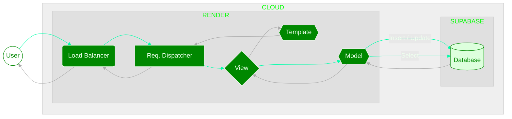
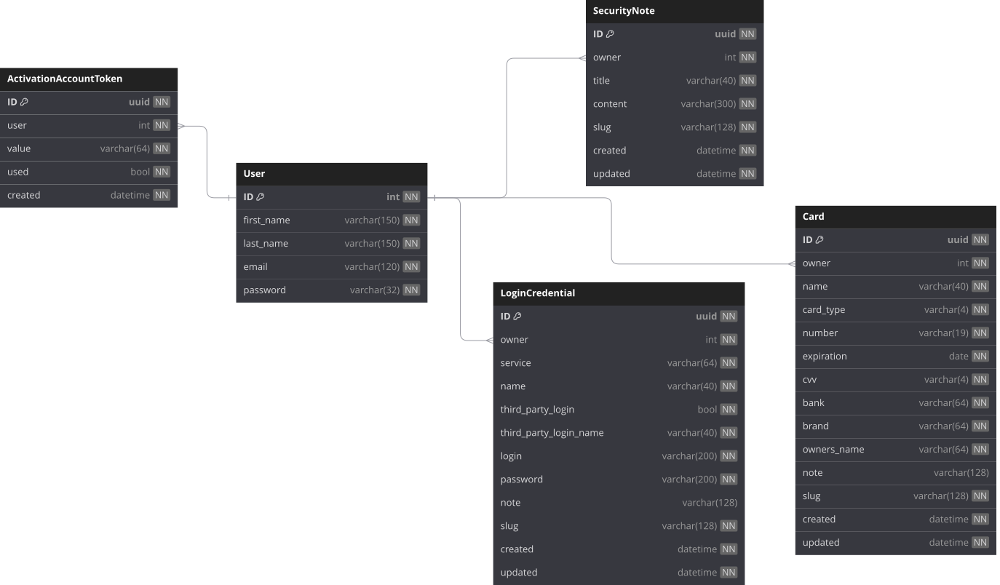

# Arch

The architecture can be detailed in general terms on two levels: web and database. The mechanics are abstracted to a general level, avoiding in-depth details that confuse rather than aggregate, presenting a behavioral vision on a "macro" scale following the flow of data without focusing on the "micro", such as each action of each function. Below is the flow of information on the Web, followed by the structuring and architecture of the Database (For more details on the Database go to [https://dbdocs.io/lucasgoncsilva04/SWARDEN](https://dbdocs.io/lucasgoncsilva04/SWARDEN)):

## Web

## DB

